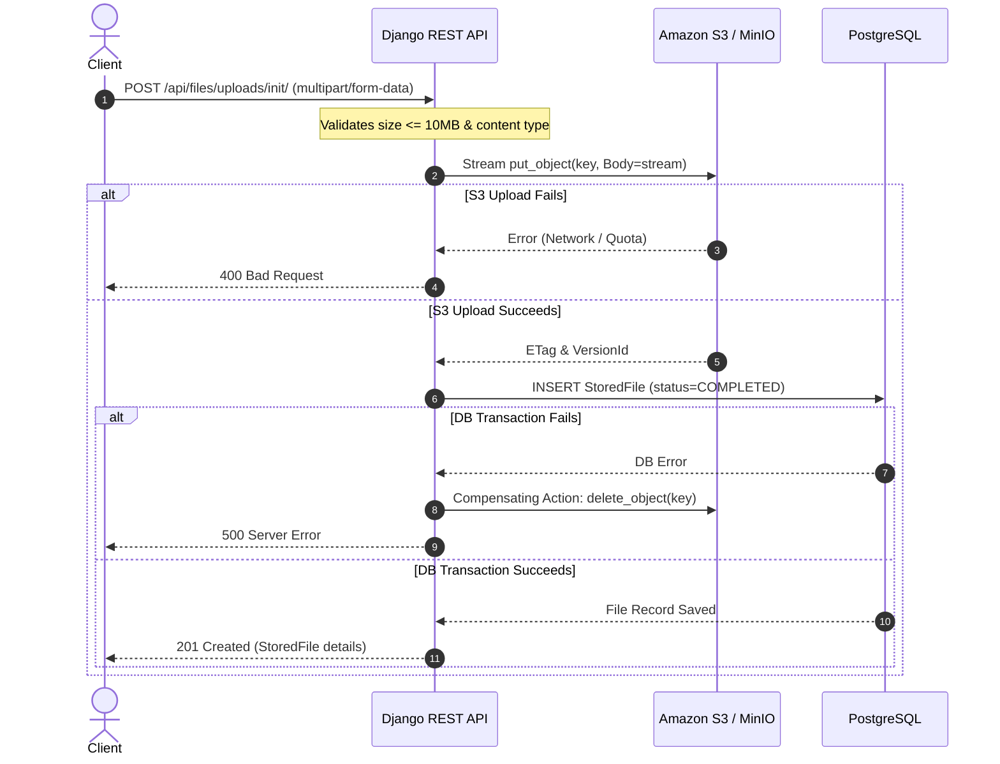
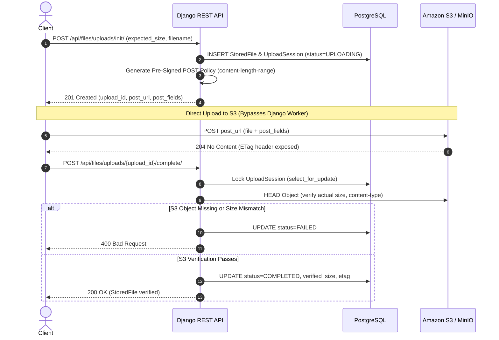
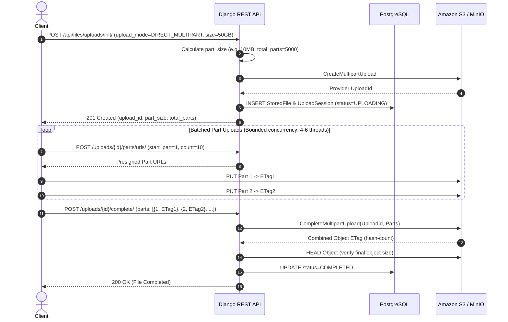
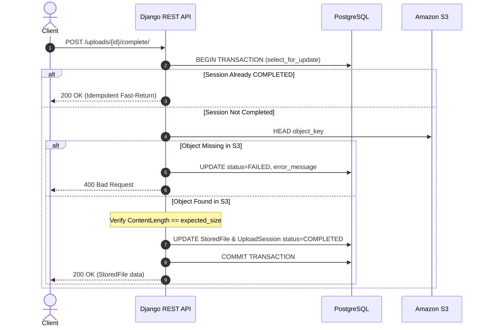
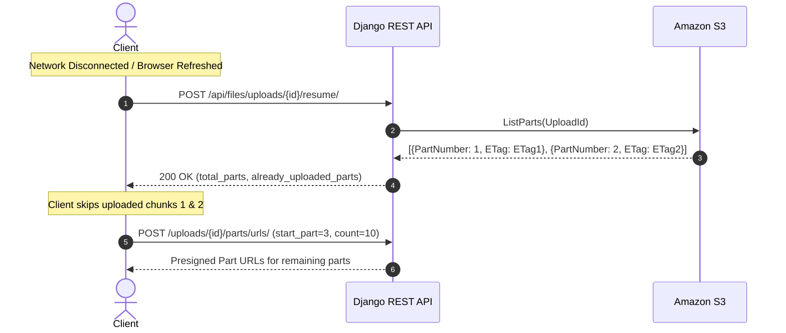
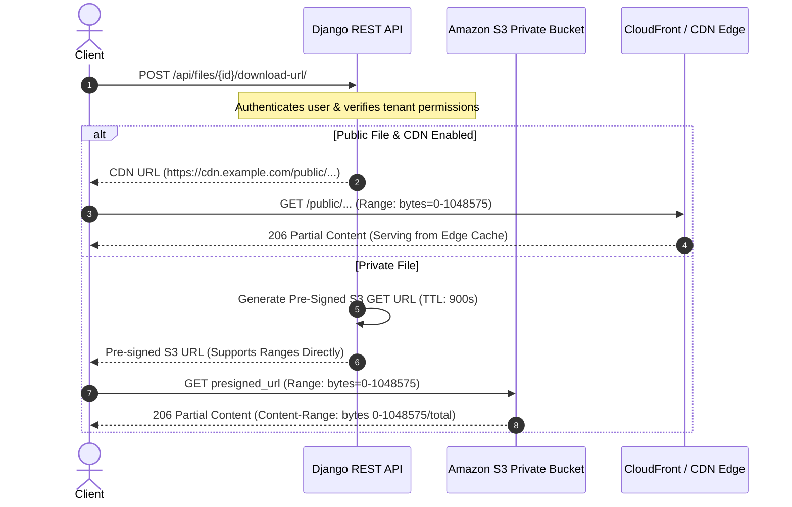
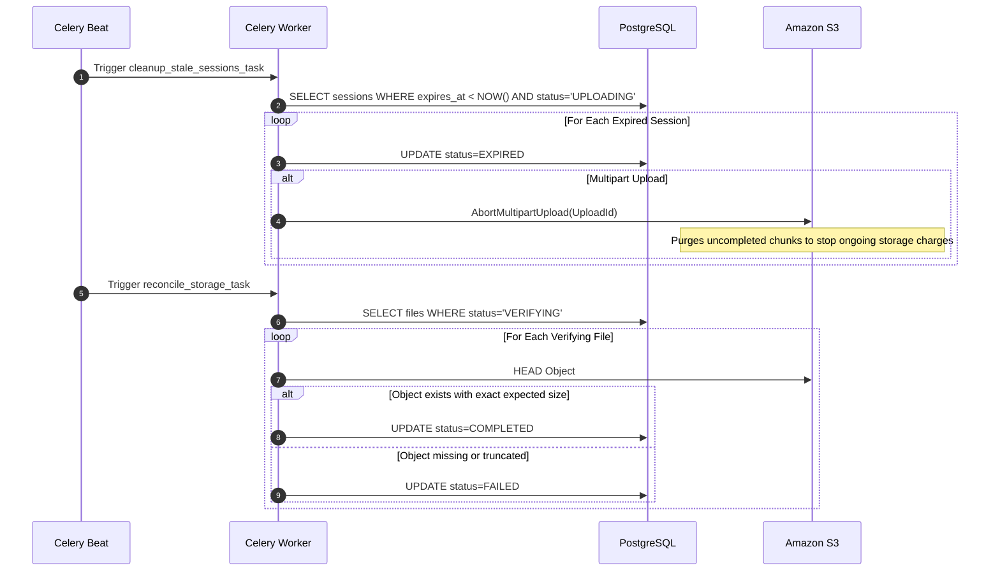
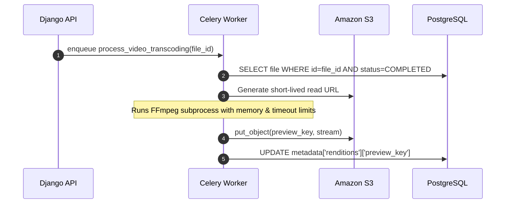

# Production-Grade Object Storage Integration System with Django REST Framework

A robust, enterprise-grade cloud file management and S3-compatible object storage integration module built with **Django REST Framework (DRF)** and **Amazon S3-compatible object storage** (AWS S3, MinIO, Cloudflare R2, Ceph).

---

## Table of Contents
1. [Architecture & System Overview](#1-architecture--system-overview)
2. [Storage Types & Distributed Systems Trade-offs](#2-storage-types--distributed-systems-trade-offs)
3. [Data Modeling & Lifecycle State Machine](#3-data-modeling--lifecycle-state-machine)
4. [Object-Key Architecture & Security](#4-object-key-architecture--security)
5. [Upload Architecture (Mode A vs Mode B vs Multipart)](#5-upload-architecture)
6. [Mermaid Sequence Diagrams](#6-mermaid-sequence-diagrams)
   - [Small Backend-Mediated Upload (Mode A)](#61-small-backend-mediated-upload)
   - [Direct Pre-Signed Upload (Mode B)](#62-direct-pre-signed-upload-post-policy)
   - [Large-File Multipart Upload](#63-large-file-multipart-upload)
   - [Upload Completion & Atomic Verification](#64-upload-completion--atomic-verification)
   - [Resuming Interrupted Multipart Upload](#65-resuming-interrupted-multipart-upload)
   - [Secure Downloads & CDN Range Requests](#66-secure-downloads--cdn-range-requests)
   - [Background Storage Reconciliation & Cost Cleanup](#67-background-storage-reconciliation--cost-cleanup)
   - [Asynchronous Video Processing Pipeline](#68-asynchronous-video-processing-pipeline)
7. [Data Integrity, Checksums & ETags](#7-data-integrity-checksums--etags)
8. [Conditional Writes & Concurrency Control](#8-conditional-writes--concurrency-control)
9. [Secure Downloads, HTTP Range Requests & CDN](#9-secure-downloads-http-range-requests--cdn)
10. [Cloud Cost & Lifecycle Management](#10-cloud-cost--lifecycle-management)
11. [REST API Specification](#11-rest-api-specification)
12. [Security Model & Hardening](#12-security-model--hardening)
13. [Local Development & Docker Setup](#13-local-development--docker-setup)
14. [Automated Testing Suite](#14-automated-testing-suite)
15. [Production Deployment & IAM Policies](#15-production-deployment--iam-policies)
16. [Troubleshooting & Provider Differences](#16-troubleshooting--provider-differences)

---

## 1. Architecture & System Overview

Traditional file upload architectures often route file bytes directly through the application server. For large files or high concurrency, this saturates web server worker threads, consumes excessive RAM, and creates severe network bottlenecks.

This system decouples **metadata persistence** from **binary payload storage**:
- **Source of Truth**: PostgreSQL tracks file ownership, tenant boundaries, upload sessions, verified byte sizes, ETags, and lifecycle states.
- **Payload Storage**: Amazon S3 / MinIO stores the raw binary data.
- **Zero-Proxy Architecture**: Web browsers stream payloads directly to S3 via pre-signed capabilities (PUT URLs or POST policies) without passing bytes through Django.
- **Pluggable Storage Layer**: Cloud-specific SDK calls (`boto3`) are isolated behind a clean `BaseStorageService` interface, making the service portable across AWS S3, MinIO, Cloudflare R2, Google Cloud Storage (S3 XML API), and Ceph.

```
+--------------------+        1. Init Session          +--------------------+
|                    | ------------------------------> |                    |
|   Client / SPA     | <------------------------------ |   Django REST API  |
|  (Web / Mobile)    |    2. Pre-signed Capability     |  (Business Logic,  |
|                    |                                 |    Permissions)    |
+--------------------+                                 +--------------------+
          |                                                      |
          | 3. Direct Streaming Upload                           | 4. Verification
          |    (Zero Django Proxy)                               |    via HEAD
          v                                                      v
+---------------------------------------------------------------------------+
|               Amazon S3 / MinIO Cloud Object Storage                       |
+---------------------------------------------------------------------------+
```

---

## 2. Storage Types & Distributed Systems Trade-offs

| Dimension | Block Storage (EBS, SAN) | File Storage (EFS, NFS) | Object Storage (S3, MinIO) |
|---|---|---|---|
| **Access Model** | Raw 512B/4KB blocks via SCSI/NVMe | Hierarchical directories via POSIX (NFS/SMB) | Flat key-value namespace via HTTP REST (GET/PUT) |
| **Latency** | Sub-millisecond (ultra-fast) | 1 - 5 milliseconds | 10 - 100 milliseconds |
| **Mutability** | In-place random read/write | In-place random read/write | Immutable (replace entire object or version) |
| **Consistency** | Strong (single host attached) | Strong to Eventual (distributed locks) | Strong read-after-write (AWS S3 since Dec 2020) |
| **Capacity** | Gigabytes to Terabytes | Terabytes to Petabytes | Exabytes (practically unlimited) |
| **Coordination** | OS filesystem driver | Network locking daemon (NLM/distributed locking) | Stateless HTTP headers (`ETag`, `If-Match`) |
| **Cost** | High ($0.08 - $0.20 / GB / month) | Medium-High ($0.30 / GB / month) | Low ($0.015 - $0.023 / GB / month) |

### Key Object Store Properties
- **No Hierarchical Directories**: S3 prefixes (e.g. `tenants/123/files/`) are string keys with delimiter semantics, not POSIX directories.
- **Never Scanned via LIST in Production**: Bucket `LIST` operations are slow ($O(N)$ with 1000-key pagination markers) and expensive ($0.005 per 1,000 requests). All file indexing, pagination, search, and access control are driven by the PostgreSQL database.

---

## 3. Data Modeling & Lifecycle State Machine

The database enforces a strict, idempotent state machine to track file transfer lifecycles:

```
    +-----------+
    |  PENDING  |
    +-----------+
          |
          v
    +-----------+       Verification Failed
    | UPLOADING | ------------------------------+
    +-----------+                               |
          |                                     |
          v                                     v
    +-----------+       Integrity Error   +------------+
    | VERIFYING | ----------------------> |   FAILED   |
    +-----------+                         +------------+
          |                                     ^
          v Successful Verification             |
    +-----------+                               |
    | COMPLETED |         Session Expired       |
    +-----------+ ------------------------------+
```

### Database Models

1. **`StoredFile`**:
   - `id`: UUID primary key.
   - `owner`: ForeignKey to `User`.
   - `tenant_id`: Indexed tenant isolation partition.
   - `object_key`: Unique S3 key (`unique=True`, `db_index=True`).
   - `expected_size` vs `verified_size`: Confirms byte delivery.
   - `etag` & `checksum`: Cryptographic verification data.
   - `status`: `PENDING`, `UPLOADING`, `VERIFYING`, `COMPLETED`, `FAILED`, `ABORTED`, `EXPIRED`.
   - `is_public`: Boolean routing public assets to CDN.

2. **`UploadSession`**:
   - `id`: UUID primary key.
   - `upload_mode`: `BACKEND_MEDIATED`, `DIRECT_SINGLE`, or `DIRECT_MULTIPART`.
   - `provider_upload_id`: S3 multipart upload ID.
   - `part_size` & `total_parts`: Geometry for chunk calculations.
   - `expires_at`: Automatic session expiration barrier.

3. **`UploadedPart`**:
   - `upload_session`: ForeignKey to `UploadSession`.
   - `part_number`: 1-indexed part number.
   - `etag`: ETag string returned by S3 for this chunk.
   - Unique constraint on `('upload_session', 'part_number')`.

---

## 4. Object-Key Architecture & Security

Object keys are generated exclusively on the server using `ObjectKeyGenerator`:

```python
# Format for private tenant files:
tenants/<sanitized_tenant_id>/files/<YYYY>/<MM>/<file_uuid>/<sanitized_filename>

# Format for public assets:
public/files/<YYYY>/<MM>/<file_uuid>/<sanitized_filename>

# Format for immutable content-addressed storage (CAS):
cas/<hash_prefix_2>/<full_sha256_digest>/<sanitized_filename>
```

### Security Defenses Built Into Object Keys:
1. **Never Trust User Filenames**: User filenames can contain directory traversal attacks (`../../etc/passwd`), null bytes (`\x00`), and carriage returns. The generator strips directories via `os.path.basename`, normalizes Unicode (NFKD), replaces non-alphanumeric characters with underscores, and retains the original display name in the database.
2. **UUID Namespace Isolation**: Prevents IDOR and object overwrites.
3. **Tenant Scoping**: Keeps multi-tenant data logically segregated.

---

## 5. Upload Architecture

### Mode A: Backend-Mediated Uploads (Small Files < 10MB)
- Intended for small payloads (avatars, small receipts).
- Streams payload directly to S3 via `put_object_stream` without loading the full file in memory.
- Enforces `BACKEND_MEDIATED_MAX_BYTES` (default: 10MB).
- **Compensating Actions**: If S3 upload succeeds but database commit fails, an automated rollback immediately issues `delete_object` to prevent orphaned storage bloat.

### Mode B: Direct Single Pre-Signed Uploads (Files 10MB - 5GB)
- Intended for moderate-sized files.
- **Why Pre-signed POST Policy is Preferred over Pre-signed PUT**:
  > [!IMPORTANT]
  > A pre-signed PUT URL does NOT by itself enforce maximum body size. A malicious user with a pre-signed PUT URL could upload a 500GB file, causing massive unexpected storage bills.
  > A pre-signed POST policy natively enforces `['content-length-range', min, max]` inside S3's authentication layer.
- After client completes upload, it notifies Django's `/complete/` endpoint.
- Django performs a `HEAD` request against S3 to verify the file's existence, size, and Content-Type before marking the record `COMPLETED`.

### Mode C: Direct Multipart Uploads (Files 10MB - 5TB)
- Required for files exceeding 100MB or unstable networks.
- Adheres to S3 limits:
  - 10,000 maximum parts.
  - Minimum part size of 5 MB (5,242,880 bytes), except final part.
- Part size calculated dynamically:
  $$\text{part\_size} = \max(\text{default\_part\_size}, \lceil \text{file\_size} / 10000 \rceil, \text{min\_part\_size})$$
- Part URLs are returned in configurable batches (e.g. 10 parts at a time) rather than returning thousands of URLs in a single response.
- Client uploads parts with bounded concurrency (4 to 6 parallel workers).
- Resuming after browser refresh: the `/resume/` endpoint calls `list_parts` in S3 to discover already uploaded chunks so the client only transmits missing parts.

---

## 6. Mermaid Sequence Diagrams

### 6.1. Small Backend-Mediated Upload


### 6.2. Direct Pre-Signed Upload (POST Policy)


### 6.3. Large-File Multipart Upload


### 6.4. Upload Completion & Atomic Verification


### 6.5. Resuming Interrupted Multipart Upload


### 6.6. Secure Downloads & CDN Range Requests


### 6.7. Background Storage Reconciliation & Cost Cleanup


### 6.8. Asynchronous Video Processing Pipeline


---

## 7. Data Integrity, Checksums & ETags

> [!WARNING]
> **Never assume an S3 ETag is an MD5 hash!**
> - For **single-part PUT uploads**: The ETag is the hex-encoded MD5 hash of the object (enclosed in double quotes).
> - For **multipart uploads**: S3 calculates the MD5 hash of each part, concatenates their raw binary checksums, hashes that concatenated string, and appends a hyphen followed by the total number of parts (e.g. `d41d8cd98f00b204e9800998ecf8427e-24`).
> Attempting to compare a multipart ETag against a client's full-file MD5 will always fail.

This system's `IntegrityService`:
1. Identifies multipart ETags via regex (`r'^[a-fA-F0-9]{32}-\d+$'`).
2. Performs metadata verification exclusively via `HEAD` requests without streaming gigabytes of data back to Django.
3. Supports streaming SHA-256 computation with $O(1)$ memory consumption.

---

## 8. Conditional Writes & Concurrency Control

To prevent race conditions, lost updates, and duplicate file overwrites:
1. **Create-Only Writes**:
   When invoking `put_object_stream`, the system passes `If-None-Match: *`. S3 rejects the operation with HTTP 412 (`PreconditionFailed`) if an object already exists at that key.
2. **Conditional Updates**:
   Supports passing `If-Match: <etag>` so clients can ensure they are modifying the exact expected version.
3. **Database Concurrency Control**:
   Session completion uses `UploadSession.objects.select_for_update()` inside `transaction.atomic()`. If two completion requests arrive simultaneously from an erratic client, the second request safely acquires the lock, detects `status == COMPLETED`, and returns the existing file record idempotently without corrupting state.

---

## 9. Secure Downloads, HTTP Range Requests & CDN

### Zero-Proxy Secure Downloads
- Django generates short-lived pre-signed S3 GET URLs (default TTL: 15 minutes).
- File bytes stream directly from S3 to the client, preserving Django application capacity.
- `Content-Disposition: attachment; filename="..."` is injected into the pre-signed signature to control browser download behavior.

### Native HTTP Range Requests (206 Partial Content)
- Pre-signed GET URLs natively support HTTP `Range` headers (`Range: bytes=0-1048575`).
- Video players and resumable download managers can request arbitrary byte ranges directly from S3 without passing range tokens through Django.

### Optional CDN Integration
- For public assets or high-traffic distribution, configuring `CDN_BASE_URL` routes downloads through CloudFront / CDN edge servers.
- Uses origin access controls (OAC) to keep the S3 origin private while delivering edge-cached assets.

---

## 10. Cloud Cost & Lifecycle Management

Incomplete multipart uploads are a primary source of hidden cloud storage costs. S3 charges for uploaded parts indefinitely until the multipart upload is explicitly completed or aborted.

### Cost Control Mechanisms:
1. **Automatic S3 Lifecycle Rule (Cloud-Side)**:
   ```json
   {
       "Rules": [
           {
               "ID": "AbortIncompleteMultipartUploads",
               "Status": "Enabled",
               "Filter": {},
               "AbortIncompleteMultipartUpload": {
                   "DaysAfterInitiation": 7
               }
           }
       ]
   }
   ```
2. **Periodic Celery Cleanup Tasks (Application-Side)**:
   - `cleanup_stale_sessions_task`: Marks expired upload sessions as `EXPIRED` and calls `abort_multipart_upload` on S3 to release chunk storage immediately.
   - `reconcile_storage_task`: Reconciles pending sessions against S3 without ever deleting completed user data.
3. **Cascading Signal Deletion**:
   When a `StoredFile` record is deleted from PostgreSQL, a `post_delete` signal removes the object from S3 automatically.

---

## 11. REST API Specification

| Method | Endpoint | Description | Auth Required |
|---|---|---|---|
| `POST` | `/api/auth/register/` | Register new user with optional tenant partition | No |
| `POST` | `/api/auth/login/` | Authenticate and obtain session | No |
| `POST` | `/api/auth/logout/` | Terminate session | Yes |
| `GET` | `/api/auth/me/` | Retrieve user profile & tenant ID | Yes |
| `POST` | `/api/files/uploads/init/` | Initialize upload (Mode A, B, or Multipart) | Yes |
| `GET` | `/api/files/uploads/{id}/` | Inspect upload session details and parts | Yes |
| `POST` | `/api/files/uploads/{id}/parts/urls/` | Get batched pre-signed part upload URLs | Yes |
| `POST` | `/api/files/uploads/{id}/complete/` | Complete and verify upload session | Yes |
| `POST` | `/api/files/uploads/{id}/abort/` | Abort session and purge provider chunks | Yes |
| `POST` | `/api/files/uploads/{id}/resume/` | List uploaded parts from S3 to resume | Yes |
| `GET` | `/api/files/` | Paginated list of authorized files (with search) | Yes |
| `GET` | `/api/files/{id}/` | File metadata detail | Yes |
| `POST` | `/api/files/{id}/download-url/` | Generate secure pre-signed download / CDN URL | Yes |
| `DELETE`| `/api/files/{id}/` | Delete file and purge cloud storage object | Yes |
| `GET` | `/api/files/{id}/status/` | Lightweight polling status endpoint | Yes |
| `GET` | `/health/` | Service health check | No |
| `GET` | `/api/docs/` | Interactive Swagger UI API documentation | No |

---

## 12. Security Model & Hardening

1. **Private Buckets by Default**: Buckets have public access blocked (`BlockPublicAcls`, `IgnorePublicAcls`, `BlockPublicPolicy`, `RestrictPublicBuckets`).
2. **Least Privilege IAM**: Direct upload access uses short-lived signatures scoped to the exact object key.
3. **No Wildcard CORS**: CORS rules specify explicit frontend origins, allowed headers (`Content-Type`, `Range`), and expose the `ETag` header.
4. **Tenant Isolation**: Users cannot inspect, download, or complete upload sessions belonging to another user or tenant (tested against IDOR).
5. **No Shell Injections**: Media processing runs with strict timeouts, validated arguments, and without shell interpolation.

---

## 13. Local Development & Docker Setup

### Prerequisites
- Docker & Docker Compose
- Or Python 3.12+ for local virtual environments

### 1. Environment Configuration
```bash
cp .env.example .env
```

### 2. Run with Docker Compose
```bash
docker compose up -d --build
```
This launches:
- **Django API** on `http://localhost:8000`
- **PostgreSQL** on `localhost:5432`
- **Redis** on `localhost:6379`
- **MinIO S3 Service** on `http://localhost:9000`
- **MinIO Admin Console** on `http://localhost:9001` (user: `minioadmin`, pass: `minioadmin`)
- **Celery Worker & Beat** for background tasks

### 3. Local Virtualenv Run (without Docker)
```bash
python3 -m venv .venv
source .venv/bin/activate
pip install -r requirements/local.txt
python manage.py migrate
python manage.py runserver
```

---

## 14. Automated Testing Suite

The project includes 54 automated tests covering unit, API, S3 storage mocks, concurrency, and failure modes.

```bash
# Activate virtual environment
source .venv/bin/activate

# Run test suite with pytest
pytest -v
```

### Test Coverage Highlights:
- **Unit**: Key sanitization against `../../etc/passwd`, Unicode normalization, S3 part geometry calculation (10k parts barrier).
- **API**: Authentication enforcement, IDOR cross-tenant denial, file pagination and status polling.
- **Storage**: PUT pre-signed URLs, POST policies with content-length conditions, multipart lifecycle, abort and resume.
- **Failure & Concurrency**: Missing S3 objects, mismatched byte sizes, duplicate completion requests (row locking), compensating deletions on database failure.

---

## 15. Production Deployment & IAM Policies

### Recommended IAM Policy for Django Application Worker
```json
{
    "Version": "2012-10-17",
    "Statement": [
        {
            "Sid": "ObjectStorageAccess",
            "Effect": "Allow",
            "Action": [
                "s3:PutObject",
                "s3:GetObject",
                "s3:AbortMultipartUpload",
                "s3:ListMultipartUploadParts",
                "s3:DeleteObject"
            ],
            "Resource": "arn:aws:s3:::my-production-bucket/*"
        },
        {
            "Sid": "BucketListMultipart",
            "Effect": "Allow",
            "Action": [
                "s3:ListBucketMultipartUploads"
            ],
            "Resource": "arn:aws:s3:::my-production-bucket"
        }
    ]
}
```

### Recommended S3 CORS Configuration
```json
[
    {
        "AllowedHeaders": ["*"],
        "AllowedMethods": ["GET", "PUT", "POST", "HEAD"],
        "AllowedOrigins": ["https://app.yourdomain.com"],
        "ExposeHeaders": ["ETag", "Content-Range", "Accept-Ranges"],
        "MaxAgeSeconds": 3000
    }
]
```

---

## 16. Troubleshooting & Provider Differences

| Issue / Provider | Root Cause | Solution |
|---|---|---|
| **MinIO Connection Refused (Subdomain resolution)** | MinIO local instances fail when requests use virtual-hosted style (`bucket.localhost:9000`). | Set `addressing_style: path` in botocore config (automatically applied by `S3StorageService` when `AWS_S3_ENDPOINT_URL` is set). |
| **CORS ETag Missing in Browser** | Browser cannot read `ETag` header from direct S3 response during multipart completion. | Ensure `ExposeHeaders: ["ETag"]` is present in bucket CORS policy. |
| **HTTP 412 Precondition Failed** | Object already exists when conditional write `If-None-Match: *` is supplied. | Indicates key collision; regenerate key or verify target file state. |
| **Cloudflare R2 Multipart Differences** | R2 adheres to S3 API, but does not support S3 Object Lock or certain ACL flags. | Keep `AWS_DEFAULT_ACL=private` and avoid bucket ACL operations. |
